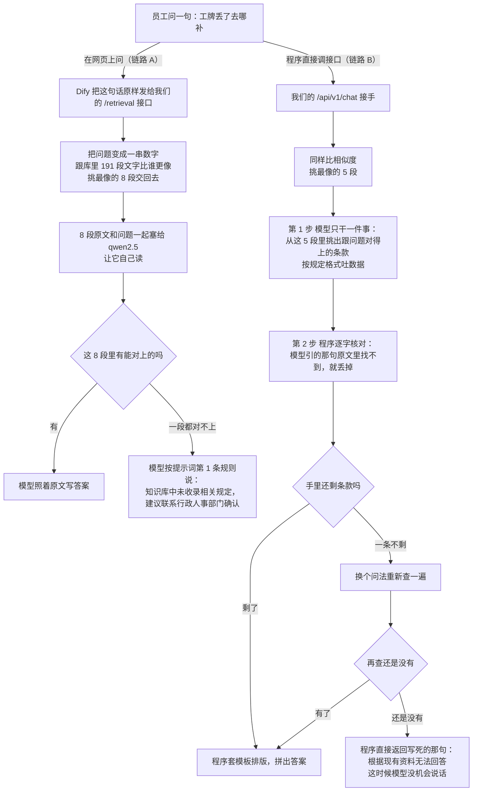
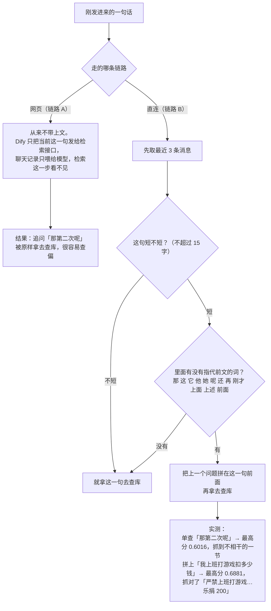

# 企业内部制度问答 RAG 系统 项目说明

只讲做什么、怎么跑、谁和谁通信。

---

# 第一部分：项目概述

## 1. 项目背景与痛点

制度散在几十个 Word 和 PDF 里。员工要查"工牌丢了去哪补""私用公司快递罚多少"，只能问人或自己翻。原来的全文搜索，关键词和制度里的表述对不上，重合率低。

这是引入 **RAG（检索增强生成）** 的直接原因：先从文档里找出相关段落，再让大模型照着这几段回答，不靠模型记忆答题。

## 2. 项目目标 & 核心价值

做两件事，其他都是配套。

1. **把制度文档变成可检索的知识**：上传 PDF/Word，自动解析、清洗、切块（长文档切成可单独检索的小块）、转向量入库。人工不建索引、不写关键词。
2. **用员工的大白话答出原文条款**：答案里的数字、条款号、房间号从原文逐字取，不让模型自己写。

不做：通用聊天、制度以外的问答、代替人工判断（比如"我这种情况算不算旷工"，只给条款不给结论）。

## 3. 适用场景 & 目标用户

**适用**：内部制度查询、人事行政流程咨询、处罚标准确认——问题有明确出处，库里有原文。

**不适用**：跨文档推理的复杂判断、需要外部信息的（政策法规、行业标准）、没有文档依据的开放问答。

| 使用者     | 怎么用                |
| ------- | ------------------ |
| 普通员工    | 网页聊天框提问，看答案和引用来源   |
| 行政 / 人事 | 上传新制度、删除过期文档、看问答记录 |
| 开发 / 测试 | 调 HTTP 接口，做集成和回归   |
| 运维      | 看健康检查、指标、日志，排查故障   |

## 4. 项目核心能力总览

一句话：上传制度文档，员工大白话提问，系统从原文找条款，逐字引用作答。

- 文档上传（PDF / DOCX，单文件 20 MB 上限），后台异步处理
- 解析、清洗、分类、切块、向量化（文字压成一串固定长度数字）、入库
- 语义检索：按意思找段落，不按字面
- 两阶段回答：模型只出结构化数据（固定 JSON，不自由发挥），程序核验后套模板渲染
- 引用溯源：标出来自哪个文件哪一节
- 多轮会话：记住最近 3 轮，支持追问
- 检索接口对外开放（含 Dify 外部知识库协议）
- 健康检查、运行指标、请求日志

---

# 第二部分：总体方案设计

## 1. 总体架构图说明（分层架构思想）

**链路**＝一次提问从发出到拿到答案，中间经过哪些程序。同一句话可以走两条路，写答案的不是同一个东西，措辞和详略会不一样；对比测试别把两边结果混着比。

|         | 链路 A：走网页                | 链路 B：直接调接口            |
| ------- | ----------------------- | --------------------- |
| 谁在用     | 员工日常提问                  | 开发和测试                 |
| 谁写答案    | Dify 里的模型（qwen2.5）      | 我们自己的程序               |
| 我们这边管什么 | 只负责找段落                  | 找段落 + 抽条款 + 核验数字 + 排版 |
| 页面入口    | `http://127.0.0.1:5500` | `POST /api/v1/chat`   |

**链路 A：网页聊天（日常在用）**

```
浏览器
  │ POST /dify/v1/chat-messages
  ▼
dev-proxy（5500 端口，托管静态页 + 转发）
  │ 去掉 /dify 前缀，注入 Dify 的 Key
  ▼
Dify（本机 80 端口，Docker 里）
  用户输入 → 知识检索 → LLM → 直接回复
  │ 检索节点向外发一次请求：
  │ POST http://host.docker.internal:8000/retrieval
  ▼
FastAPI（8000 端口）
  │ bge-m3 把问题转成 1024 维向量
  ▼
PostgreSQL + pgvector（191 个块）
  │ 余弦距离取前 8 条
  ▼
回到 Dify 的 LLM 节点（qwen2.5:7b，温度 0.2）
  ▼
浏览器
```

我们的程序只做"找段落"。回答由 Dify 里的 qwen2.5（通义千问 7B，本地大模型）用 Dify 里那份 472 字提示词生成。项目里那套两阶段提示词、逐字核验、模板渲染，在这条路上完全不执行。

**链路 B：直连接口（开发调试用）**

```
调用方 → FastAPI /api/v1/chat → 检索 → 模型输出 JSON → 程序核验 → 模板渲染 → 返回
```

没有网页也没有 Dify，谁用谁直接发 HTTP 请求给 8000。那几百行提示词、逐字核验、模板排版，只有走这条路才执行。

**为什么分两条**：Dify 的会话管理、引用展示、界面编排现成，接入快；我们这边有数字逐字核验，准但接口裸。并存是过渡状态，不是设计目标。

## 2. 整体业务流程（端到端流转）

以"上班迟到怎么处理"走链路 A 为例：

1. 浏览器把问题发给 5500 端口的代理
2. 代理转发给 Dify，顺手带上 Key
3. Dify 的检索节点调 8000 的 `/retrieval`，要 8 条
4. 8000 把问题转成向量，查库，按相似度取 8 条，返回纯文本片段
5. Dify 把这 8 条塞进提示词，交给 qwen2.5
6. 模型输出答案（迟到 10 分钟内乐捐 20 元、超过 3 次算严重旷工等）
7. Dify 返回答案 + 引用来源，浏览器渲染

实测整条约 2 秒，其中检索约 0.1 秒，其余基本都是模型生成。

## 3. 技术选型原则

标准是"本地能跑、不花钱、中文效果好"，没做多方案对比。

| 组件                    | 选它的原因                       |
| --------------------- | --------------------------- |
| FastAPI               | Python 框架，支持异步，自带接口文档，改动快   |
| PostgreSQL + pgvector | 向量和业务数据放一个库，不用维护两套存储，事务能对齐  |
| bge-m3                | 中文检索效果好，本地可跑，1024 维，不用调 API |
| qwen2.5:7b            | 本地 7B 里中文指令跟随够用，单卡能跑        |
| Ollama                | 本地模型管理简单，一条命令拉模型            |
| Dify                  | 会话管理、界面编排现成，省掉前端对话轮子的开发     |

**Chroma**（独立部署的向量库）装过、compose 里也挂了目录，但代码零引用、实际没用。存储只有 pgvector（PostgreSQL 的扩展，让数据库能存向量、算相似度）一套。

## 4. 系统分层划分

| 层       | 实际组件                                      | 代码位置                                              | A（网页）干什么            | B（直连）干什么             |
| ------- | ----------------------------------------- | ------------------------------------------------- | ------------------- | -------------------- |
| 接入层     | dev-proxy（5500）、Dify nginx（80）            | `RAG-frontend/dev-proxy.py`                       | 转发 + 注入 Key         | 不参与                  |
| 应用服务层   | FastAPI（8000）                             | `app/main.py`、`app/api/routers/`                  | 只暴露 `/retrieval`    | 全部接口                 |
| RAG 检索层 | `RAGService`、`VectorStore`                | `app/services/rag_service.py`、`src/vector_store/` | 编码 + 取 8 条          | 编码 + 取 5 条 + 微调 + 过滤 |
| 模型推理层   | Ollama（11434）                             | 外部进程                                              | 不参与（Dify 直连 Ollama） | 抽取 JSON              |
| 存储层     | PostgreSQL 18.6 + pgvector 0.8.6          | 本机 5432                                           | 只读 chunks           | 读写全部表                |
| 运维监控层   | `/health/live`、`/health/ready`、`/metrics` | `app/api/routers/health.py`                       | 探活                  | 探活                   |

---

# 第三部分：核心功能模块说明

## 1. 对话交互能力

网页上一个聊天框，能连续追问。**输入**一句话，1–2000 字；**输出**答案 + 引用来源 + 会话号。

- 会话号由前端保存，第二轮起带上，Dify 据此取历史
- 对话历史保留最近 3 轮，更早的丢弃
- 前端单次等 60 秒，超时提示"请求超过 60 秒未响应，请稍后重试"
- 没有限流，没有并发排队提示

**通信**：浏览器 → 5500 代理 → Dify → 8000 检索 → 回 Dify → 浏览器。

## 2. 知识库检索问答能力（RAG 核心）

把问题变成向量，在库里找最像的段落。**输入**问题文本 + top_k（一次返回几条）；**输出**若干段原文，带相似度分数。

相似度靠 **Embedding（把文字压成一串数字，数字接近就是意思接近）**：bge-m3 把每段文字和问题都压成 1024 个数字，算**余弦距离**（衡量方向差异，越小越像，相似度＝1 减它），越接近排越前。

实测：

- 库里 191 个块，35,220 字，来自 5 份文档
- 108 个块（57%）不足 150 字，碎片偏多
- 18 个块装了 8 条以上处罚条款，最密的 16 条
- 正样本最低 0.5618，负样本最高 0.6918，区间重叠 → 分数不能当"答不答得出"的裁判

**召回（捞出候选段落这一步）的短板**：一块塞了 16 条处罚，它的向量是这 16 条意思的平均值。问其中一条，整块不突出，容易排到后面。

## 3. 文档接入与处理能力

**输入** `.pdf` 或 `.docx`，最大 20 MB；**输出**任务号 + 后台任务，结果写进 `chunks` 表。顺序：落盘校验 → 解析 → 清洗 → 分类 → 切块 → 转向量 → 入库（细节见第五部分 1 节）。

上传立即返回 202，字段 `task_id`、`status`、`stage`、`source_file`、`poll_url`，之后轮询 `GET /api/v1/documents/{task_id}`。

- `status`：`processing`、`succeeded`、`needs_review`、`skipped`、`failed`
- `stage`：`queued`、`parsing`、`cleaning`、`classifying`、`chunking`、`indexing`、`finished`

任务表在内存里，服务重启记录就没了，已入库数据不受影响。

## 4. 知识库管理能力

**能做**：列文档（`GET /api/v1/documents`）、查任务状态、删文档（`DELETE /api/v1/documents/{source_file}`，按文件名删该文件所有块）、重建（重传同一文件，旧块先删后插）。

**不能做**：

- 建多个知识库（只有一个库，表里没有库的概念）
- 改单个块的内容（只能删了重传）
- 增量同步（改了源文件要整个重传）
- 文档权限分级（能调接口就能删，只校验是不是管理员 token）

## 5. 提示词 / 工作流编排能力

**Dify 那边（页面在用）**：4 节点可视化编排，提示词在 LLM 节点的 SYSTEM 框里，472 字、6 条规则，改完点"发布"生效不用重启。库存 `draft` 和已发布两份，线上跑已发布那份。

**代码这边（目前不调用）**：提示词硬编码在 `app/services/rag_service.py`。

| 常量                          | 行号      | 作用              |
| --------------------------- | ------- | --------------- |
| `_EXTRACTION_SYSTEM_PROMPT` | 120–178 | 抽取规则，8 条        |
| `_EXTRACTION_SCHEMA`        | 81–117  | 要求模型输出的 JSON 结构 |
| `_ALIGN_SYSTEM_PROMPT`      | 197–214 | 改写问题用的提示词       |
| `_ALIGN_SCHEMA`             | 216–220 | 改写的输出结构         |

没有热加载、版本记录、A/B，改一次重启一次。这四段常量只有 `POST /api/v1/chat` 用到，页面走 Dify 不碰这个接口。查 2026-10-30 服务日志，`/api/v1/chat` 没有真实用户请求记录，也就是这套提示词至今一次都没在线上跑过。

## 6. 输出能力

**引用溯源**：答案下面列文件名 + 章节名。页面引用由 Dify 生成，直连接口由程序从 `sources` 字段渲染。

**格式化**：直连接口走模板，不让模型自由发挥。真实输出形如：

```
一、规定明确的部分：
- 原文：「工牌遗失需到 406 室补办，工本费纸 5 元、绳 5 元、壳 10 元。」[文档1]
```

**拒答**有两种，不是同一句：

| 链路       | 拒答话术                        | 谁产生的                                                 |
| -------- | --------------------------- | ---------------------------------------------------- |
| 页面（Dify） | "知识库中未收录相关规定，建议联系行政人事部门确认。" | 模型按提示词第 1 条复述                                        |
| 直连接口     | "根据现有资料无法回答。"               | 代码常量 `_NO_CONTEXT_ANSWER`（`rag_service.py:45`），模型不参与 |

页面那句不是硬拦截，是模型照指令说的。检索断了（返回空片段）也会触发它——Dify 检索失败不报错，拿空片段继续往下走。所以"真查不到"和"检索断了"在页面上长得一样，看不出区别。

## 7. 权限与用户管理能力

只有接口级鉴权，没有用户体系。

- Bearer token 精确匹配，表在 `.env` 的 `RAG_MOCK_TOKENS`，格式 `token:user_id`，逗号分隔
- 角色 `user`、`admin`，删文档要求 admin
- 没有登录、注册、密码、token 过期

免鉴权路径：`/health/*`、`/metrics`、`/retrieval`（Dify 调用，自己有独立密钥校验）、`/docs`、`/openapi.json`。

## 8. 接口开放能力（对外 API）

按谁负责访问分三类，因为三方要的凭证不同：

- **页面**：上传文档、发问题、查历史，带用户登录后的 token
- **Dify**：只有 `/retrieval`，它把这个当外部知识库查，带另一把密码 `dify-rag-key`
- **监控**：`/health/live`、`/health/ready`、`/metrics`，看服务活不活、有多少请求

---

# 第四部分：组件清单与组件详细说明

## 1. 后端主服务（FastAPI）

所有 HTTP 接口的入口。职责：路由分发、参数校验、鉴权、检索编排、模型调用、结果渲染、落库。对上收 HTTP，对下用 `asyncpg` 连 PostgreSQL、`httpx` 调 Ollama。依赖 PostgreSQL、Ollama、本地 bge-m3 模型目录。代码量：`app/` 约 6000 行，其中 `rag_service.py` 单文件 1600 行。启动：`uvicorn app.main:app --host 0.0.0.0 --port 8000`。版本见第七部分 2 节。

## 2. 大模型推理服务（Ollama）

本地跑大模型的工具，装好后一条命令拉模型，对外提供 HTTP 推理接口。监听 11434，`POST http://127.0.0.1:11434/api/chat`，收 prompt 返回文本或 JSON。已装 `qwen2.5:7b`（约 4.7 GB，Q4 量化）。靠 GPU，CPU 能兜底但慢很多。注意：Dify 也直连它，两个调用方共用一个模型实例，同时请求会排队。

## 3. 向量数据库（pgvector）

存向量、算相似度。挂在 PostgreSQL 上的扩展，不是独立服务，也没有独立端口。`chunks` 表的 `embedding vector(1024)` 列用 `<=>` 算余弦距离。不用 Chroma：装过但代码零引用，两套存储要保证同步，反而容易出问题。

## 4. 关系型数据库（PostgreSQL）

存业务数据、文档元数据、块内容、对话记录。表：users、sessions、messages、api_keys、chunks，外加一个沙盒表 `chunks_split`。5432 端口，`postgresql://rag_user@localhost:5432/rag_db`。本机装的是 18.6，compose 里的 pg16 镜像没启用。建表 `scripts/init-db.sql`，迁移脚本在 `scripts/migrations/`。

## 5. 文本处理 & 切分组件

`src/chunker.py`、`src/chunk_strategies.py`、`src/cleaner.py`。清洗：去零宽字符、统一全半角、合并多余空行。按文档类型选切法，四种：FAQ 型（一问一答一块）、制度条款型（按条款）、流程型（按步骤）、表单型（按表项）。库内调用，不对外；输入是解析产出的 `DocumentBlock` 列表。

## 6. Embedding 向量化模型

bge-m3，中文效果不错的 Embedding 模型，本地目录 `D:\AI\Models\bge-m3`，1024 维。路径由 `RAG_EMBEDDING_MODEL_PATH` 指定，目录不存在服务起不来。问题和文档块必须用同一个模型编码，否则算出来的距离没意义。进程内加载（transformers），不走网络，启动时一次性加载、占内存约 2 GB。

## 7. 文档解析组件

`src/loaders/pdf_loader.py`、`src/loaders/word_loader.py`。PDF 用 PyMuPDF 按页取文本，识别页眉页脚（同位置反复出现的行），产出 `heading`、`paragraph` 两类块，**不产出表格块**；Word 用 python-docx 按段落和表格取，产出 `heading`、`paragraph`、`table` 三类块。库内调用。

## 8. 缓存组件

没有。没有 Redis，没有进程内缓存，每次提问都重新编码、重新查库。现在量小（191 块），检索本身只要 0.1 秒，瓶颈不在这。

## 9. 网关 / 鉴权组件

两个，别混：

- **dev-proxy**（`RAG-frontend/dev-proxy.py`，5500）：托管静态页 + 转发 `/dify/*` 到 Dify，转发时注入 Dify 的 API Key。开发用，不是生产网关。
- **鉴权中间件**（`app/middleware/auth.py`）：校验 Bearer token，解析 user_id 和 role 挂到请求上下文。免鉴权路径白名单在这里。

## 10. 前端交互组件

`D:\python-learn\RAG-frontend`，纯静态、无框架，约 3000 行：`index.html` + `js/`（config、api、app、markdown、mock 两件）+ `css/styles.css`。职责：渲染聊天界面、保存会话号、发请求、按 Markdown 渲染答案、显示引用来源。`fetch` 打 5500 的 `/dify/v1/chat-messages`，5500 代理不在跑，页面就打不开。

## 11. 容器编排组件（Docker）

只有 Dify 在容器里，FastAPI、Ollama、PostgreSQL 都是本机进程。根目录那份 `docker-compose.yml` 定义 pg16 + 后端，但没用它启动，实际手动跑。在跑的容器：`docker-api-1`、`docker-worker-1`、`docker-db_postgres-1`、`docker-nginx-1`、`docker-ssrf_proxy-1` 等。已知异常：`docker-agent_backend-1`、`docker-local_sandbox-1` 一直在 Restarting 循环，不影响主链路。

## 12. 第三方依赖组件（Dify）

开源 LLM 应用编排平台，Docker 自托管、本机 80 端口，本项目用它做页面聊天。应用：`企业制度问答助手`（advanced-chat），另有 `规章制度ai`、`问题分类+知识库+聊天机器人` 两个闲置应用。工作流 4 节点：用户输入 → 知识检索 → LLM → 直接回复。知识来源是外部知识库，指向 `http://host.docker.internal:8000`，密钥 `dify-rag-key`；模型 qwen2.5:7b，温度 0.2（越低越死板越稳定）。取几条由**知识库自己的设置**决定（`datasets.retrieval_model.top_k = 8`），工作流节点上那个 top_k 输入框不生效。通信：`POST /v1/chat-messages`（前端调）、`POST /retrieval`（它调我们）。

---

# 第五部分：关键流程详细拆解

## 1. 文档入库全流程

**上传 → 解析 → 清洗 → 分块 → 向量化 → 入库**

| 步骤      | 输入         | 输出                 | 关键动作                                                                           |
| ------- | ---------- | ------------------ | ------------------------------------------------------------------------------ |
| 1. 落盘校验 | 上传的文件      | 临时文件 + 任务号         | 1 MB 一块读；超 20 MB 返回 413；读前 1 KB 判文件头；扩展名只收 `.pdf`/`.docx`；目录名用 `token_hex(16)` |
| 2. 解析   | 文件路径       | `DocumentBlock` 列表 | PDF 按页取文本，识别页眉页脚；Word 按段落和表格取                                                  |
| 3. 清洗   | 块列表        | 干净块列表              | 去零宽字符、统一全半角、合并空行、去页眉页脚残留                                                       |
| 4. 分类   | 干净块列表      | 文档类型               | 按特征打分，四类：FAQ / 制度 / 流程 / 表单。分不清标 `needs_review`                                |
| 5. 分块   | 块列表 + 类型   | `chunk` 列表         | 按类型选切法，每块带 `source_file`、`section`、`chunk_index`                               |
| 6. 向量化  | chunk 文本   | 1024 维向量           | bge-m3 批量编码                                                                    |
| 7. 入库   | chunk + 向量 | `chunks` 表记录       | 同一 `source_file` 先删后插，保证重传不重复                                                  |

**失败处理**：任一步抛异常，任务标 `failed`，记 `failed_stage` 和 `error_code`。已入库的块不回滚（重传会覆盖）。

**为什么先删后插**：库里没有唯一约束，重传同一文件会插两份，检索时重复内容占满名额。

## 2. 异常请求处理流程

统一响应结构：

```json
{"error_code": "VALIDATION_ERROR", "message": "message 长度需在 1-2000 之间", "request_id": "..."}
```

**真实存在的错误码**（不要凭印象写别的）：

| 场景                  | HTTP | error_code                             |
| ------------------- | ---- | -------------------------------------- |
| 参数不合法               | 400  | `VALIDATION_ERROR`                     |
| 没带 token / token 无效 | 401  | `UNAUTHORIZED`                         |
| 权限不够（删文档非 admin）    | 403  | `FORBIDDEN`                            |
| 资源不存在               | 404  | `NOT_FOUND`                            |
| 文件超 20 MB           | 413  | `FILE_TOO_LARGE`                       |
| 并发名额抢不到             | 503  | `SERVICE_UNAVAILABLE`                  |
| 检索不可用               | 503  | `RETRIEVAL_UNAVAILABLE`                |
| 生成失败                | 500  | `INTERNAL_ERROR`（message 是"AI 回答生成失败"） |

## 3. 检索链路：能不能查到、查不到怎么办、什么时候带上文

先记住一件事：**"找资料"和"判断能不能答"是两回事。** 找资料那一步永远只干"把最像的几段捞出来"，捞不到好的也照样凑满数交差。真正判断"这题库里有没有答案"的，页面那条链路交给大模型，直连接口那条链路是模型挑一遍、程序再核对一遍。

### 一 & 二：能不能查到、查不到怎么办



图上没画出来但要知道的三点：

- **过滤线没起作用**。Dify 传来的 `score_threshold` 是 0，直连的 `min_score` 默认也是 0，代码里写的都是"小于等于 0 就不筛"。所以 A 永远交满 8 段、B 永远拿到 5 段，库里 191 段永远凑得齐。**后端根本不知道自己查没查到**，它只负责取最像的几条。
- **分数也不能拿来当尺子**。实测：该答得出的问题，最低分 0.5618；本来不该答的问题，最高分 0.6918。两个区间重叠了——0.6 分可能是对的，0.65 分可能是错的。所以"分数低于多少就直接拒答"这种规则用不了。
- **两条链路查不到时的三处差别**：谁来判断（A 全靠模型读 8 段 / B 是模型挑 + 程序核对）；说的话不一样（A 是"知识库中未收录相关规定…"，B 是"根据现有资料无法回答。"）；拦不拦（A 不拦，模型自己照着规则说的；B 拦，程序把固定句子直接返回，模型不参与）。

**页面上的隐患**：万一检索服务挂了、或者返回空内容，模型手里一段资料都没有，照样会说那句"未收录"。所以在页面上看，"库里真的没有"和"后端压根没查成"长得一模一样，分不出来，只能去翻后端日志。

### 三：什么时候带上文



两个补充：

- 挑不出条款（空手）的时候，是**改写问题再重新查一次**，不是只改提示词。只改提示词不重查，库里剩下的候选段还是按老问法捞出来的那批，换说法也没用。
- 一处和本文别处对不上：别处写"对话历史保留最近 3 轮"，实际取的是 **3 条消息**（一问一答算 2 条，也就是约 1.5 轮）。

---

# 第六部分：数据设计

## 1. 数据分类

| 类别     | 存在哪                           | 内容            |
| ------ | ----------------------------- | ------------- |
| 业务元数据  | `users`、`sessions`、`api_keys` | 用户、会话、密钥      |
| 文档分片数据 | `chunks` 的文本列                 | 块的原文、来源、章节、序号 |
| 向量数据   | `chunks.embedding`            | 每块 1024 个浮点数  |
| 对话日志   | `messages`                    | 每轮的问题、答案、引用来源 |

## 2. 核心数据表说明

**users**（2 行）

| 字段         | 类型          | 说明               |
| ---------- | ----------- | ---------------- |
| id         | varchar     | 主键，如 `user-001`  |
| username   | varchar     | 显示名              |
| role       | varchar     | `user` / `admin` |
| created_at | timestamptz | 创建时间             |

**sessions**（235 行）

| 字段                      | 类型          | 说明                       |
| ----------------------- | ----------- | ------------------------ |
| id                      | varchar     | 主键，格式 `sess_` + 12 位十六进制 |
| user_id                 | varchar     | 属于谁                      |
| title                   | varchar     | 会话标题，取第一句话               |
| created_at / updated_at | timestamptz | 时间戳                      |

**messages**（530 行）

| 字段         | 类型          | 说明                    |
| ---------- | ----------- | --------------------- |
| id         | bigserial   | 主键                    |
| session_id | varchar     | 属于哪个会话                |
| role       | varchar     | `user` / `assistant`  |
| content    | text        | 内容                    |
| sources    | jsonb       | 引用来源（只对 assistant 有值） |
| created_at | timestamptz | 时间戳                   |

**chunks**（191 行）——核心表

| 字段                                         | 类型           | 说明                                    |
| ------------------------------------------ | ------------ | ------------------------------------- |
| id                                         | bigserial    | 主键                                    |
| source_file                                | varchar      | 源文件名，删文档按它删                           |
| section                                    | varchar      | 所属章节，空值存空字符串不是 NULL                   |
| chunk_index                                | int          | 在本文件内的序号，**不同文件会重复，不能单独当 ID**         |
| text                                       | text         | 块原文                                   |
| embedding                                  | vector(1024) | 向量                                    |
| doc_type                                   | varchar      | `faq` / `policy` / `process` / `form` |
| question                                   | text         | 仅 FAQ 型有值                             |
| stage / responsible_department / form_name | varchar      | 流程型和表单型用，多数为空                         |

**api_keys**（2 行）——**建了但没用**，代码不读这张表，鉴权走 `.env`。

## 3. 数据流转规则

```
上传 → chunks 表（文本 + 向量）
提问 → 编码 → 查 chunks → 返回片段
     → messages 表（问题 + 答案 + 来源）
删文档 → 按 source_file 删 chunks（不删 messages）
```

---

# 第七部分：部署方案

## 1. 部署架构

**单机，四个本机进程 + 一组容器。** 没有多副本，没有负载均衡。

```
本机（Windows 11）
├── FastAPI（8000）        ← Dify 调它检索
├── dev-proxy（5500）      ← 浏览器打开这个
├── Ollama（11434）        ← Dify 和 FastAPI 都调它
├── PostgreSQL（5432）     ← 带 pgvector
└── Docker
    └── Dify 全家桶（80 端口对外）
```

进程间全靠本机回环，没有跨机通信。Dify 在容器里，通过 `host.docker.internal` 访问宿主机 8000。

**为什么 FastAPI 不进容器**：模型加载要走本地路径，进容器要挂卷、装 torch，调试麻烦。

## 2. 环境依赖清单

| 依赖           | 要求               | 当前版本                       |
| ------------ | ---------------- | -------------------------- |
| 操作系统         | Windows 10/11    | Windows 11                 |
| Python       | 3.10+            | 3.11（`.venv` 里，FastAPI 未锁版本） |
| PostgreSQL   | 14+，需装 pgvector  | 18.6 + pgvector 0.8.6      |
| Ollama       | 任意近版             | 本机安装                       |
| 模型           | qwen2.5:7b       | 约 4.7 GB，Q4 量化             |
| Embedding 模型 | bge-m3           | 本地目录 `D:\AI\Models\bge-m3` |
| Docker       | 需 WSL2 后端        | Docker Desktop             |
| 显卡           | 6 GB 显存以上（7B Q4） | 单卡                         |

Python 包（`requirements.txt`，未锁版本）：fastapi、uvicorn、pydantic、pydantic-settings、asyncpg、httpx、PyMuPDF、python-docx、transformers、torch、numpy、pytest。

---

# 第八部分：接口说明

## 1. 接口总览

共 20 个路由，分四组：

| 方法     | 路径                                    | 作用           | 鉴权             |
| ------ | ------------------------------------- | ------------ | -------------- |
| POST   | `/api/v1/chat`                        | 问答（两阶段）      | Bearer         |
| POST   | `/api/v1/retrieval/search`            | 只检索不生成       | Bearer         |
| GET    | `/api/v1/conversations`               | 列会话          | Bearer         |
| POST   | `/api/v1/conversations`               | 建会话          | Bearer         |
| GET    | `/api/v1/conversations/{id}`          | 会话详情         | Bearer         |
| DELETE | `/api/v1/conversations/{id}`          | 删会话          | Bearer         |
| GET    | `/api/v1/conversations/{id}/messages` | 列消息          | Bearer         |
| POST   | `/api/v1/documents`                   | 上传文档         | Bearer         |
| GET    | `/api/v1/documents`                   | 列文档          | Bearer         |
| GET    | `/api/v1/documents/{task_id}`         | 查任务状态        | Bearer         |
| DELETE | `/api/v1/documents/{source_file}`     | 删文档          | Bearer + admin |
| GET    | `/api/v1/auth/me`                     | 查当前用户        | Bearer         |
| POST   | `/retrieval`                          | Dify 外部知识库协议 | 独立密钥           |
| GET    | `/health/live`                        | 进程活着吗        | 免              |
| GET    | `/health/ready`                       | 数据库和模型就绪吗    | 免              |
| GET    | `/metrics`                            | 运行指标         | 免              |
| GET    | `/docs`、`/openapi.json`               | 接口文档         | 免              |

## 2. 核心入参出参说明

**POST /api/v1/chat**

```json
{
  "message": "工牌丢了怎么补办",
  "session_id": "sess_a1b2c3d4e5f6"
}
```

| 字段           | 必填  | 说明                                    |
| ------------ | --- | ------------------------------------- |
| `message`    | 是   | 问题，1–2000 字。**字段名是 message，不是 query** |
| `session_id` | 否   | 不带就新建会话                               |

响应：

```json
{
  "session_id": "sess_a1b2c3d4e5f6",
  "answer": "一、规定明确的部分：\n- 原文：「…」[文档1]",
  "sources": [
    {"source": {"source_file": "某某公司管理制度.pdf", "section": "工牌管理", "chunk_index": 12}, "score": 0.71}
  ],
  "message_count": 4,
  "persisted": true,
  "request_id": "req_xxx"
}
```

**没有** `message_id`、`retrieval_ms`、`generation_ms`（上一版文档写错过）。

**POST /retrieval**（Dify 用）

```json
{
  "knowledge_id": "default",
  "query": "私自更换门锁",
  "retrieval_setting": {"top_k": 8, "score_threshold": 0.0}
}
```

```json
{
  "records": [
    {"content": "…原文…", "score": 0.72, "title": "某某公司管理制度.pdf", "metadata": {"section": "…"}}
  ]
}
```

`score_threshold` 传 0 或 null 时不过滤。`query` 为空返回 `records: []`，Dify 用这个测连通性。

## 3. 调用示例

```bash
# 健康检查
curl --noproxy '*' http://127.0.0.1:8000/health/ready

# 普通问答（首轮不带 session_id）
curl --noproxy '*' -X POST http://127.0.0.1:8000/api/v1/chat \
  -H "Authorization: Bearer test-token-user-001" \
  -H "Content-Type: application/json" \
  -d '{"message":"工牌丢了怎么补办"}'

# 只检索不生成
curl --noproxy '*' -X POST http://127.0.0.1:8000/api/v1/retrieval/search \
  -H "Authorization: Bearer test-token-user-001" \
  -H "Content-Type: application/json" \
  -d '{"query":"私自更换门锁","top_k":3}'

# 模拟 Dify 调检索（排查页面为什么不答）
curl --noproxy '*' -X POST http://127.0.0.1:8000/retrieval \
  -H "Authorization: Bearer dify-rag-key" \
  -H "Content-Type: application/json" \
  -d '{"knowledge_id":"default","query":"会议室怎么预订","retrieval_setting":{"top_k":2,"score_threshold":0}}'

# 上传文档
curl --noproxy '*' -X POST http://127.0.0.1:8000/api/v1/documents \
  -H "Authorization: Bearer test-token-admin" \
  -F "file=@D:/docs/制度.pdf"
```

**Windows 上必须加 `--noproxy '*'`**：本机设了 `http_proxy=127.0.0.1:64026`，不加会走代理，回环请求被转出去，报假的 502。

---

# 第九部分：附录

## 1. 术语表

| 术语              | 一句话解释                                              |
| --------------- | -------------------------------------------------- |
| RAG             | 检索增强生成。先从文档找到相关段落，再让模型照着回答，不靠模型记忆                    |
| Embedding       | 把文字压成一串固定长度的数字（本项目 1024 个）。意思越接近，两串数字越接近              |
| 向量库             | 专门存这种数字串、按"接近程度"快速查的数据库。本项目用 pgvector 扩展，不是独立服务     |
| pgvector        | PostgreSQL 的扩展，让数据库能存向量、算余弦距离                      |
| 分块（chunk）       | 把长文档切成小块，每块单独存、单独检索。本项目共 191 块                     |
| 召回              | 从库里找出候选段落这一步。召回不好，后面全白搭                             |
| 重排（rerank）      | 对召回结果再排一次序。本项目**没有模型重排**，只有按元数据加减分的规则                |
| 向量化             | 把文字变成向量的动作，和 Embedding 是同一件事的两个说法                  |
| Ollama          | 本地跑大模型的工具，一条命令拉模型，对外提供 HTTP 接口                     |
| Chroma          | 独立的向量数据库。本项目装过、配置过，但代码没用，实际存储只有 pgvector              |
| 余弦距离            | 衡量两串数字方向差异的算法。值越小越像，相似度＝1 减去它                      |
| HNSW            | 一种向量索引结构，查得快但占内存                                   |
| bge-m3          | 中文效果不错的 Embedding 模型，本项目用它把文字转成向量                  |
| qwen2.5:7b      | 通义千问 7B。本项目用它生成答案和抽条款                              |
| Dify            | 开源 LLM 应用编排平台。本项目用它做页面聊天，它通过外部知识库协议调我们的检索接口           |
| Token           | 模型处理文本的最小单位。中文大致一个字一个 token                        |
| 温度（temperature） | 控制模型发挥程度的参数。越低越死板越稳定，本项目定 0.2                      |
| top_k           | 取几条。Dify 那边取 8 条，直连接口最多取 5 条                       |
| 提示词（prompt）     | 给模型的指令文本。本项目一部分在 Dify，一部分硬编码在代码里                   |
| 幻觉              | 模型编出原文里没有的内容。本项目靠提示词和低温度压制，链路 B（直连）另有逐字核验             |

## 2. 缩略语

| 缩写   | 全称                                | 中文                          |
| ---- | --------------------------------- | --------------------------- |
| RAG  | Retrieval-Augmented Generation    | 检索增强生成                      |
| LLM  | Large Language Model              | 大语言模型                       |
| API  | Application Programming Interface | 应用程序接口                      |
| HTTP | HyperText Transfer Protocol       | 超文本传输协议                      |
| JSON | JavaScript Object Notation        | 一种数据格式                      |
| SQL  | Structured Query Language         | 结构化查询语言                      |
| SSRF | Server-Side Request Forgery       | 服务端请求伪造。Dify 有防护，默认不让访问内网地址 |
| MB   | Megabyte                          | 兆字节                         |

## 3. 参考资料

**代码位置**

- 后端：`D:\python-learn\RAG-learn`，入口 `app/main.py`
- 前端：`D:\python-learn\RAG-frontend`，入口 `index.html`
- 建表：`scripts/init-db.sql`
- 测试：`tests/`，155 个用例

**运行时地址**

- 接口文档：`http://127.0.0.1:8000/docs`
- 页面：`http://127.0.0.1:5500`
- Dify 编排：`http://127.0.0.1`（或 Dify 控制台端口）

**外部文档**

- pgvector：https://github.com/pgvector/pgvector
- Ollama：https://ollama.com/
- bge-m3：https://huggingface.co/BAAI/bge-m3
- Dify 外部知识库协议：https://docs.dify.ai/zh/self-host/use-dify/knowledge/connect-external-knowledge-base
- FastAPI：https://fastapi.tiangolo.com/

**配置备份位置**

- Dify 工作流和知识库配置：`D:\Temp\dify_backup\`
