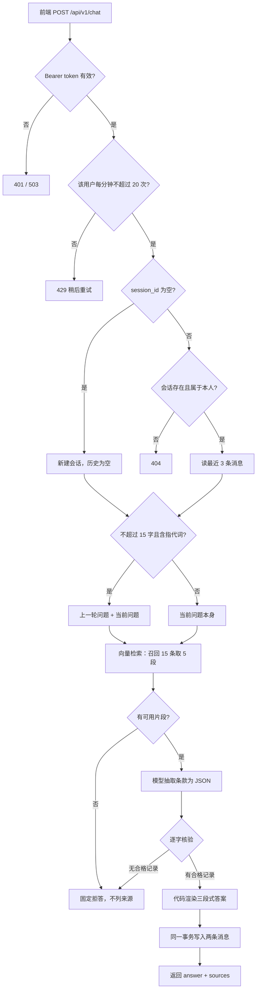
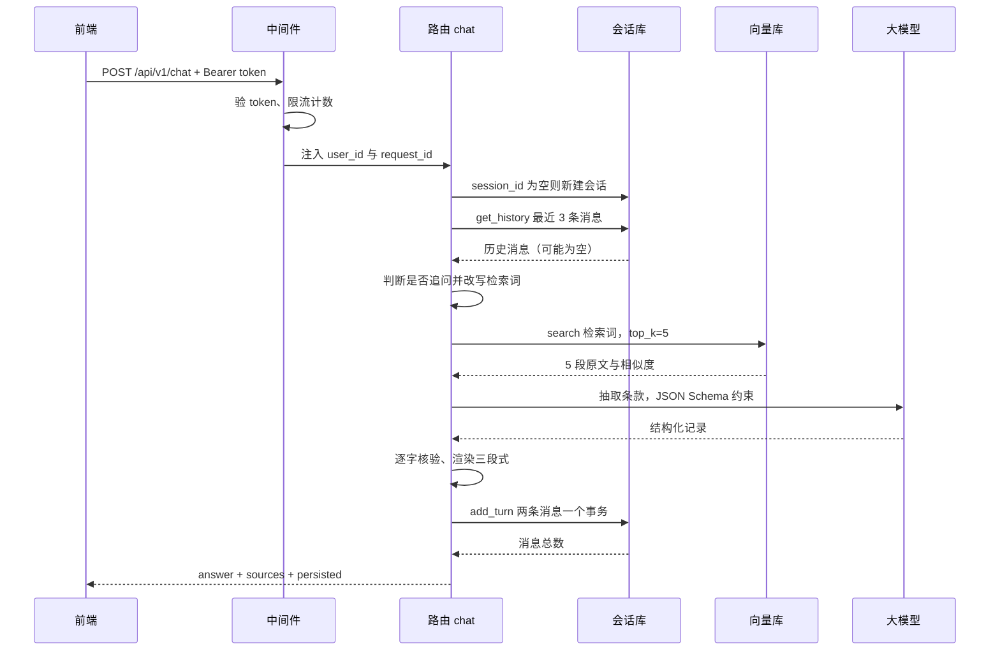
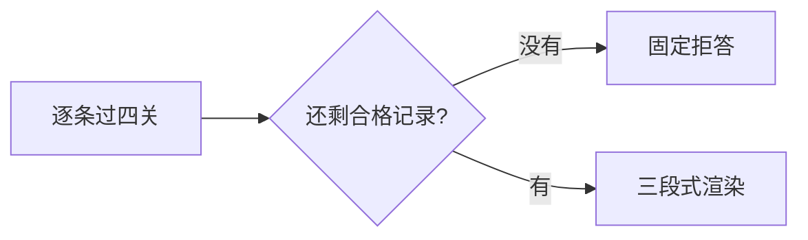

# RAG 制度问答服务

把公司制度文档变成「可逐字溯源的问答」：用户问一句话，服务从制度原文中检索条款、抽取结构化记录、逐字核验后拼成答案，并标注每条结论出自哪一段原文。

---

## 1. 这套服务做什么

| 做 | 不做 |
|---|---|
| 从制度原文中找出与问题相关的条款 | 不凭常识或推理补全原文没有的规定 |
| 按「规定 / 处罚 / 未明确」三段输出 | 不用自然语言自由发挥、不复述用户问题 |
| 为每条结论标注来源片段编号 | 不在找不到依据时给一个「看起来合理」的答案 |

最高约束：**答案中的每一句都必须能在制度原文里找到**；找不到就明说找不到。

---

## 2. 全链路总览



对应代码路径：

```
app/main.py              中间件注册、资源装配
app/api/routers/chat.py  单轮对话编排：取历史 → 检索生成 → 落库 → 组装响应
app/services/rag_service.py  检索、抽取、核验、渲染
src/session/             会话与历史的读写
src/vector_store/        pgvector 检索与时间微调
```

---

## 3. 请求如何进入后端

### 3.1 中间件顺序

服务基于 FastAPI/Starlette；**后注册的中间件在外层**，因此执行顺序如下。

| 顺序 | 组件 | 职责 | 失败结果 |
|---|---|---|---|
| 1 | `RequestContextMiddleware` | 生成或校验 `X-Request-ID` 并注入，在响应头回显 | — |
| 2 | `TokenAuthMiddleware` | 解析 Bearer token → 注入 `user_id` → 每人每分钟限流 | 401 / 429 / 503 |
| 3 | 路由 + Pydantic | 字段校验、字符串去首尾空白 | 422 |

两个细节：

- `X-Request-ID` 来自客户端时属不可信输入，只保留 `[A-Za-z0-9_.-]` 并截断至 32 字符，防止伪造日志行。
- `/health*`、`/docs`、`/openapi.json`、`/redoc` 完全豁免鉴权；`/auth/me` 只免限额、仍需鉴权。

### 3.2 请求体校验

| 字段 | 规则 | 说明 |
|---|---|---|
| `message` | 1–2000 字 | 首尾空白被自动去掉 |
| `session_id` | `sess_` + 12 位十六进制，可空 | 空 = 在空窗口开新会话 |
| `top_k` | 1–20，默认 5 | 实际取 `min(top_k, max_sources)` |

`session_id` 非空但查不到时会返回 404，**不会静默新建**——避免前端状态错乱后把对话写到错的会话里。

### 3.3 有没有清洗

有，但**只发生在入库侧**，在线链路不做文本加工。

| 环节 | 做什么 | 位置 |
|---|---|---|
| 离线入库 | Unicode NFC 归一、PDF 异体字映射修复、删除 emoji、删除不可见控制字符、去除重复页眉页脚、压缩连续空行、保留换行结构；输出可追溯的清洗报告 | `src/ingest.py` → `src/cleaner.py` |
| 在线提问 | 仅去首尾空白 | `ChatRequest.str_strip_whitespace` |

在线链路**不做**改写、纠错、同义扩展、敏感词过滤。原因：任何改写都会让「用户原话」和「落库内容」不一致，后续无法复盘；脏数据应当在入库阶段解决。

---

## 4. 是否携带上下文

这是整套流程中最容易被误解的一层。判断由**确定性代码**完成，不经过模型。

### 4.1 三层与门

| 层 | 判据 | 代码 | 不满足时 |
|---|---|---|---|
| 1 | 请求是否带 `session_id` | `chat.py` | 视为全新会话 |
| 2 | 历史是否非空、归属本人、未删除 | `session_manager.get_history` | 历史为空，等于无上下文 |
| 3 | 当前问题 **≤ 15 字** 且含指代词 | `_build_contextual_query` | 使用原始问题检索 |

指代词为固定 12 个：`那 / 这 / 它 / 他 / 她 / 呢 / 还 / 再 / 刚才 / 上面 / 上述 / 前面`。

两个条件必须同时满足。长句默认自带完整语义，不拼接；短句但没有指代词（如「加班费怎么算」）也不拼接。

### 4.2 上下文从哪里来

**每次都查数据库，没有内存缓存，也没有会话对象。**

```
get_history(session_id, user_id, limit=3)
  → 校验归属与删除状态，不通过直接返回空列表
  → SELECT ... FROM messages ORDER BY timestamp DESC LIMIT 3
  → 反转为时间正序
```

`limit=3` 的单位是**消息条数**（约一轮半对话），不是轮数。

不缓存的代价是每轮多一次查询；收益是会话被删除后，旧消息不会残留在内存里继续被使用——这也是软删除必须在读历史处再校验一次的原因。

### 4.3 携带上下文时如何回答

```
检索词 = 上一轮的 user 消息 + 空格 + 当前问题
例：「那罚多少钱」 → 「我带宠物上班可以吗 那罚多少钱」
```

改写后的检索词同时用于两处：向量检索、抽取提示词中的「用户问题」字段。

除此之外**没有别的区别**——后续检索、抽取、核验、渲染完全走同一套逻辑。所以「带上下文」改变的只是检索能否命中正确主题，不改变答案的结构和判定规则。

### 4.4 未携带上下文时如何回答

检索词就是当前问题本身，同样走完整链路：

- 命中制度条款 → 正常输出三段式答案；
- 命中的片段与问题无关 → 抽取记录与问题无词面交集，直接拒答；
- 没有任何片段 → 直接拒答。

**以上任何一种结果都不会退回「让模型自由生成」的路径。**

### 4.5 关键结论

历史消息本身**不进入提示词**。多轮上下文只通过「检索词改写」这一个动作生效。

这样做的目的是让上下文无法污染条款抽取：模型看到的永远只有制度原文和一句检索词，不会因为上一轮答案的措辞而改变本轮的取证结果。

由此产生一条已知限制，见第 10 节第 1 条。

---

## 5. 答案如何产生

### 5.1 时序



### 5.2 检索

从全部片段里挑出最像的 5 条。**不判断能否回答问题**，那是 5.3、5.4 的事。

| 步骤 | 做什么 | 数量 |
|---|---|---|
| ① 编码 | 问题转成 1024 个数字（BGE-M3 向量） | 1 句 → 1 组数字 |
| ② 召回 | 在 `chunks` 表算余弦相似度，取分数最高的若干条 | 154 → 15 |
| ③ 重排 | 问题含时间词时按时间接近度微调分数 | 15 → 15，仅顺序变 |
| ④ 截断 | 留前 5 条 | 15 → 5 |

15 条 = `max(top_k × 3, 10)`，`top_k` 默认 5。留余量是因为 ③ 会改顺序，只捞 5 条则第 6、7 名没有位置可升。

时间加减分：完全一致 `+0.05`，相差 1 天内 `+0.04`，相差 14 天以上 `−0.04`，中间不动；无时间词则整步跳过。幅度压小是为了不推翻语义排序。

`score = 1 − 余弦距离`，越大越像，但它是**排序依据，不是置信度** —— 0.55 分也可能正是答案。

### 5.3 抽取

模型**不写答案**，只把原文里相关的条款抄成结构化记录。输入是 5 段带编号的原文（`[文档1]`~`[文档5]`）+ 用户问题，以「饲养宠物会有什么处罚」为例：

```json
{
  "records": [
    {
      "kind": "penalty",
      "action": "在公司范围内饲养任何宠物",
      "condition": "鱼类除外",
      "consequence": "乐捐200 元/次，并立即将宠物带离公司",
      "source_id": 1,
      "evidence": "严禁在公司范围内饲养任何宠物，鱼类除外。若发现违规饲养宠物，饲养者将乐捐200 元/次，并立即将宠物带离公司。"
    }
  ],
  "gaps": []
}
```

| 字段 | 含义 | 上例 |
|---|---|---|
| `action` | 原文规定的行为，照抄原文用词 | 在公司范围内饲养任何宠物 |
| `condition` | 适用限定，无则填「无」 | 鱼类除外 |
| `consequence` | 原文的处罚或后果，无则填「无」 | 乐捐200 元/次，并立即将宠物带离公司 |
| `source_id` | 该句所在片段，对应 `[文档N]` | `1` |
| `evidence` | 该句原文，逐字照抄 | 见上方 `evidence` |
| `kind` | 模型自报处罚或规范 | `penalty`，核验时不采信（5.4） |
| `gaps` | 问题问到、原文没写的方面 | `[]` |

`evidence` 必须能在片段里原样找到，差一个空格也会被丢弃 —— 上例 `乐捐200 元/次` 的空格就来自原文。

模型不判断能否回答、不组织措辞、不标注来源，这三件都由代码做（5.4、5.5）。

结构可解析 ≠ 内容正确：模型仍可能写原文没有的字，所以每条记录都要过 5.4 的逐字核对。

### 5.4 核验

模型交回的每条记录都要过四关，任一不过就作废。**「不许编造」真正生效的地方就在这里。**

| 关卡 | 检查什么 | 不过的后果 |
|---|---|---|
| ① | `source_id` 落在本次 5 段范围内 | 丢弃 |
| ② | `evidence` 能在该片段里逐字找到（至少 6 字） | 丢弃 |
| ③ | `action` 能在原文里找到（证据本身或它所在片段） | 丢弃 |
| ④ | `consequence` 出现在 `evidence` 里 | **降级为规范**：保留行为，但不说处罚 |

四关之外还有三条约定：

- **证据允许向前或向后扩一句。** 模型常把「严禁…」和「若发现…乐捐」拆成两条证据，接回相邻句才不会把真处罚判成无据。
- **处罚的行为与后果必须同处一条证据**，否则丢弃。防的是「行为取自 A 句、处罚取自 B 句」的跨句错配。
- **`kind` 不采信模型声明**，由「后果有据 + 含处罚用语」推导。模型常把「必须报备」标成处罚、把「扣 1 分」标成规范。

每条记录各自过关，整批的归宿只有两种：



若某些片段有明显处罚句却一条处罚都没产出，会对这几个片段**再抽一次**，结果同样要过四关；最多一次、最多 3 段。

### 5.5 渲染与降级

答案由代码拼装，句式固定为三段：

```
一、规定明确的部分：
- 原文：「……」 [文档1]
二、相关处罚及适用范围：
- 原文规定的行为「……」：处罚 [文档1][文档2]
三、原文未明确的部分：
- 现有资料未明确说明：……是否允许
```

实际输出示例（问题：我带宠物上班可以吗）：

```
一、规定明确的部分：
- 原文：「因公需求携带宠物进入公司的情况除外，但需提前一天向行政中心提交报备申请」 [文档1]
二、相关处罚及适用范围：
- 原文规定的行为「在公司范围内饲养任何宠物（鱼类除外）」：乐捐200 元/次 [文档1]
- 原文规定的行为「在公司范围内饲养宠物（鱼类除外）」：扣除行政分1分 [文档5]
- 以上 2 条处罚在原文中对应的行为都包含「在公司范围内饲养」，均针对该行为。
三、原文未明确的部分：
- 现有资料未明确说明：非因公携带宠物是否允许
```

注意最后一段：原文只规定了「因公携带」需报备，对「非因公」没有规定。系统不会替它补一条，而是明确标为未明确。

以下情况直接返回固定文案「根据现有资料无法回答。」，且 `sources` 为空：

| 触发条件 | 说明 |
|---|---|
| 抽取结果不是合法 JSON | 结构约束失效即降级 |
| 所有记录核验失败 | 无可信内容 |
| 记录与问题无词面交集 | 检索到了但答非所问 |
| 检索有结果但全部低于阈值 | 仅在 `min_score > 0` 时生效，默认关闭 |

**任何降级都不会退回自由生成。** 这是刻意的：宁可答不出，不可编造。

这一条来自实测教训。早期版本由模型直接回答，出现过这样的链路：模型先自行补出一条原文没有的规定（例如「未经报备携带宠物进入公司不允许」），再在这条自造规定上推理，最后宣称「关于携带的处罚，资料未明确」——而上下文中两条罚则都在。改成抽取 + 逐字核验后，这类内容在机制上无法进入答案。

---

## 6. 数据如何落库

| 表 | 本次请求的作用 | 关键字段 |
|---|---|---|
| `chunks` | 只读，检索原料 | `text`、`embedding`、`source_file`、`heading_path` |
| `sessions` | 读（校验归属）+ 写（新建 / 更新活跃时间） | `session_id`、`user_id`、`updated_at`、`deleted_at` |
| `messages` | 读（历史）+ 追加两条 | `message_id`、`role`、`content`、`timestamp`、`retrieved_chunks` |

三条写入约定：

- **一轮对话原子写入**：用户消息与助手消息在同一事务提交，不存在「有问无答」的半轮。半轮会被下一轮当成上下文，导致重复作答。
- **排序可控**：同一事务内两条 INSERT 会拿到相同时间，因此显式写入 `timestamp`，助手消息取 `base + 1ms`，保证 `ORDER BY timestamp` 稳定。
- **写失败不丢答案**：返回 200，`persisted=false`、`message_count=null`，让调用方知道这一轮未入库。此时不再回查数据库——数据库正故障，补查只会把已生成的答案一起丢掉。

新会话若在本轮失败，会被回收，不在会话列表里留下空壳。

---

## 7. 接口

| 方法 | 路径 | 用途 |
|---|---|---|
| POST | `/api/v1/chat` | 发送一条消息并获取回答 |
| POST | `/api/v1/retrieval/search` | 仅检索，返回片段与相似度 |
| POST | `/api/v1/conversations` | 新建会话 |
| GET | `/api/v1/conversations` | 会话列表 |
| POST | `/api/v1/conversations/{id}/delete` | 逻辑删除会话 |
| GET | `/api/v1/conversations/{id}/messages` | 会话消息 |
| GET | `/api/v1/auth/me` | 当前身份 |
| GET | `/health/live`、`/health/ready` | 存活 / 就绪 |
| GET | `/metrics` | 进程内运行指标（需鉴权） |

响应的 `sources` 是**真正支撑本次答案的片段**，不是检索到的全部；拒答时为空数组。前端据此不会出现「答不出却列一堆来源」。CORS 当前未启用，浏览器访问需通过同源反向代理。

---

## 8. 关键参数

| 参数 | 默认 | 含义 |
|---|---|---|
| `max_sources` | 5 | 进入抽取的片段上限 |
| `context_window` | 3 | 参与改写判断的历史消息条数 |
| `min_score` | 0（关闭） | 片段最低相似度 |
| `max_concurrency` | 3 | 同时处理的问答数，单卡 GPU 实际串行 |
| `rate_limit_per_minute` | 20 | 每人每分钟请求数，滑动窗口 |
| `temperature` | 0.2 | 抽取阶段的随机性 |

并发名额只等 100 毫秒，拿不到立即返回 503，不排队。限流计数在**进程内内存**中，多副本部署时实际放行量会成倍放大。

---

## 9. 状态码

| 码 | 含义 | 是否可重试 |
|---|---|---|
| 401 | 未带 token 或 token 无效 | 换 token |
| 404 | 会话不存在或不属于当前用户 | 否 |
| 422 | 请求参数不合法 | 修正参数 |
| 429 | 超出每人每分钟额度 | 按 `Retry-After` 等待 |
| 503 | 服务未就绪 / 检索不可用 / 并发已满 | 可重试 |
| 500 | 抽取调用失败等未预期异常 | 视情况 |

**拒答不是错误码**：知识库确实没有答案时返回 200，正文为固定拒答文案。

---

## 10. 已知边界

1. **三连追问会断链。** 落库存的是原始输入，不是改写后的检索词。第三轮只读到第二轮的「那罚多少钱」，主题词已经丢失。
2. **15 字是硬阈值。** 16 字即使带「这个」也不改写；短但无指代词的独立问题不受影响。
3. **条款提取存在方差。** 长片段末尾的罚则句可能被模型漏读（片段本身召回正常）；补抽只跑一次，实测仍有个别轮次整段处罚缺失。
4. **时延偏高。** 单次抽取 6–10 秒，触发补抽时 16–20 秒。
5. **句式固定。** 答案由模板渲染，不如自由生成自然——这是用流畅度换可审计性。
6. **限流不跨进程。** 多副本需换成共享存储（Redis 等）才成立。
7. **CORS 未启用。** 跨域直连会被浏览器拦截。

---

## 11. 常见追问

**会话删了，旧消息还会被当上下文用吗？**
不会。读历史的第一步就校验 `deleted_at IS NULL` 与归属，任一不通过直接返回空列表。软删除必须在读路径再验一次，否则就是「界面删了、回答还在引用旧对话」。

**拿到别人的 `session_id` 能读对话吗？**
不能。历史查询、消息列表、写入都带 `user_id` 条件，非归属者与「不存在」返回同一结果，不泄露会话是否存在。

**同一会话并发发两条，顺序会乱吗？**
同一轮内的问与答不会乱（`timestamp` 显式写入，助手消息 +1ms）。跨请求的严格全序未保证，需要全序应给消息表增加序号列。

**知识库新增文档后要重启服务吗？**
不需要。检索每次直连数据库，无进程内缓存。但更换嵌入模型必须重建全部向量，否则新旧向量不在同一空间。

**时延主要花在哪？**
检索通常几十毫秒，抽取 6–10 秒是主要成本，触发补抽时整体 16–20 秒。要优化应减少抽取次数或缩小片段范围，而不是换更快的检索。

**能改成流式输出吗？**
收益有限。答案由代码一次性渲染，不是逐字生成；中间件也刻意避开会干扰数据流的实现，为将来留了口子。

---

## 12. 本地启动

依赖：PostgreSQL（pgvector，默认 5432）、Ollama（默认 11434，模型 `qwen2.5:7b`）、本地 BGE-M3 权重。

```powershell
# 1. 建库建表（首次）
psql -U postgres -d <db> -f scripts/init-db.sql

# 2. 配置环境变量
Copy-Item .env.example .env    # 按实际填写模型路径、数据库连接、测试 token

# 3. 启动服务
cd D:\python-learn\RAG-learn
.\.venv\Scripts\python.exe -m uvicorn app.main:app --host 127.0.0.1 --port 8002
```

验证：

```bash
curl --noproxy "*" http://127.0.0.1:8002/health/ready

curl --noproxy "*" -X POST http://127.0.0.1:8002/api/v1/chat \
  -H "Authorization: Bearer test-token-user-001" \
  -H "Content-Type: application/json" \
  -d '{"session_id": null, "message": "我带宠物上班可以吗"}'
```

首个响应中的 `session_id` 需保存，后续追问带上它才会触发上下文判断。

---

## 13. 测试与目录

```powershell
.\.venv\Scripts\python.exe -m unittest discover -s tests
```

```
app/          HTTP 层：路由、中间件、schema、服务编排
src/          数据层：解析、清洗、切块、嵌入、检索、会话存储
scripts/      建表与迁移 SQL
tests/        单元测试（纯逻辑，不依赖模型与数据库）
data/         原始文档、切块结果与归一化中间产物
```
